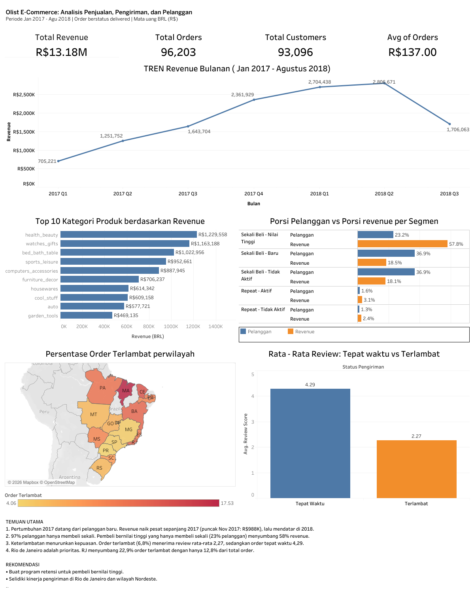

# Olist E-Commerce Analysis: Sales, Delivery, and Customer Retention

An end-to-end analysis of 96,000+ delivered orders from a Brazilian marketplace, built with **Python** and **Tableau**. The project looks at what drives revenue, how delivery delays affect customer satisfaction, and why customers rarely come back.

**Live dashboard:** [Olist E-Commerce Dashboard on Tableau Public](https://public.tableau.com/app/profile/muhamad.fahrudin/viz/OlistE-CommerceDashboard_17938854673210/OlistE-CommerceDashboard)



---

## Business Questions

1. How did sales develop over time, and which product categories drive revenue?
2. Do late deliveries hurt customer reviews, and where are delays concentrated?
3. How many customers come back to buy again, and which customers matter most?

## Dataset

- **Source:** [Brazilian E-Commerce Public Dataset by Olist](https://www.kaggle.com/datasets/olistbr/brazilian-ecommerce) (Kaggle)
- **Tables used:** orders, order items, customers, payments, reviews, products, sellers, category translation
- **Analysis scope:** orders with status `delivered`, January 2017 to August 2018 (2016 is excluded because monthly order volume was too small to compare)
- **Size after cleaning:** 96,203 orders, 93,096 unique customers, 109,872 order-item rows

## Tools and Methods

| Stage | Tools | What was done |
|---|---|---|
| Data preparation | Python (pandas, NumPy) | Loaded 8 tables, checked missing values and duplicates, converted dates, merged tables with left joins, filled missing categories, kept the latest review per order |
| Feature engineering | Python | Created `delivery_days`, `delay_days`, `is_late`, and `order_month` |
| Analysis | Python (pandas, Matplotlib, Seaborn) | Monthly trend, top categories, delay vs. review score, state-level delay analysis, RFM segmentation, cohort retention |
| Visualization | Tableau Public | One dashboard with KPIs, trend, categories, customer segments, delay map, and review comparison |

Key modeling decisions:

- Revenue is the sum of item `price` and excludes freight.
- Customers are identified by `customer_unique_id`, not `customer_id` (which is generated per order).
- Delay and review analysis is done at **order level** so multi-item orders are not counted more than once.
- Payments were not used for revenue because one order can have several payment rows.

## Key Findings

**1. Growth in 2017 came from new customers.**
Monthly revenue grew from R$112K (Jan 2017) to a peak of R$988K (Nov 2017), then stayed flat between roughly R$830K and R$980K through 2018. The top 10 categories make up about 62% of revenue, led by `health_beauty`, `watches_gifts`, and `bed_bath_table`.

**2. 97% of customers bought only once.**
Only 3.0% of customers placed more than one order. Cohort retention in the month after the first purchase is just 0.2% to 0.7%, and it is stable across cohorts, so the flat revenue in 2018 is consistent with slowing new-customer growth rather than falling retention.

**3. One-time, high-value buyers carry the revenue.**
Customers in the top spending quartile who bought once are 23% of customers but generate 58% of revenue.

| Segment | % of customers | % of revenue |
|---|---|---|
| One-time, high value | 23.2% | 57.8% |
| One-time, recent | 36.9% | 18.5% |
| One-time, inactive | 36.9% | 18.1% |
| Repeat, active | 1.6% | 3.1% |
| Repeat, inactive | 1.3% | 2.4% |

**4. Late deliveries are linked to much lower reviews.**
6.8% of orders arrive late. Late orders average a review score of **2.27**, versus **4.29** for on-time orders.

**5. Delays are concentrated in a few places, and Rio de Janeiro stands out.**
- Highest late rates: Maranhão (17.5%), Ceará (13.8%), Bahia (12.2%).
- Rio de Janeiro has 12.8% of all orders but **22.9% of all late orders**. Its average delivery time (about 14.8 days) is the same as Rio Grande do Sul, yet its late rate is twice as high (12.1% vs. 6.1%), which points to a performance or estimation issue rather than distance.

## Recommendations

1. **Run a retention program for high-value buyers.** They already show willingness to spend, and the repeat rate is extremely low, so even a small lift in repeat purchases could matter.
2. **Investigate delivery performance in Rio de Janeiro and the Nordeste region.** If Rio's late rate fell to São Paulo's level (4.5%), the overall late rate could drop from 6.8% to about 5.8%. This is a rough estimate that assumes everything else stays the same.
3. **Review delivery time estimates** for states where actual delivery time is similar but late rates differ widely.

## Limitations

- The relationship between delays and reviews is a **correlation**, not proof of cause and effect.
- Only `delivered` orders are analyzed, so cancelled and unavailable orders are excluded.
- The state analysis covers 17 states with at least 500 orders (about 95% of all late orders). Smaller states are not shown on the map.
- "High value" means total spend in the top 25% of customers; "inactive" means below-median recency (about 218 days). These are analytical cutoffs, not definitions from the source data.
- The data covers about 20 months, so long-term repeat behavior cannot be observed.
- Retention and segment results do not explain *why* customers do not return; no acquisition or marketing data is available.

## Repository Structure

```
olist-project/
├── data/
│   ├── raw/          # original Kaggle CSV files (not committed)
│   ├── clean/        # cleaned CSV outputs
│   └── tableau/      # Excel files used by the dashboard
├── notebooks/
│   └── 01_analysis.ipynb
├── images/
│   └── dashboard.png
└── README.md
```

## How to Reproduce

1. Download the dataset from Kaggle and place the CSV files in `data/raw/`.
2. Install dependencies: `pip install pandas numpy matplotlib seaborn openpyxl`
3. Run `notebooks/01_analysis.ipynb` from top to bottom. The notebook exports the cleaned files to `data/clean/` and `data/tableau/`.
4. Open the Excel files in Tableau to rebuild the dashboard.

## Author

**Muhamad Fahrudin**
Data Analyst candidate | Bandung, Indonesia
[GitHub](https://github.com/mmufaah) | [LinkedIn](https://linkedin.com/in/mmufaah)
